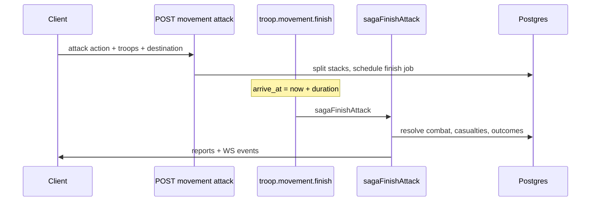

# Slice 024 — Player-vs-player combat

**Status**: Proposed (not implemented on `main`).

## Summary

Introduce **explicit combat** when a player's troops **attack** a map cell occupied by another player (troops, outpost, or city). Today [`010`](../010-troop-movement-combat/spec.md) handles peaceful `MovementAction` values only; arrival always merges friendly stacks or creates outposts—**no hostility check**, **no casualties**, **no capture/loot**.

This slice defines scope, preconditions, resolution, defenders, outcomes, movement integration, notifications, system-AI behavior, and edge cases. Implementation should extend movement/saga patterns (pg-boss finish job + `Communication` reports + WebSocket events) rather than a separate real-time battle server.

**Depends on**: troops ([`009`](../009-troops-stationary/spec.md)), movement ([`010`](../010-troop-movement-combat/spec.md)), outposts ([`011`](../011-outposts/spec.md)), cities ([`006`](../006-city-lifecycle-gathering/spec.md)), reports ([`012`](../012-communication-reports/spec.md)), world grid ([`005`](../005-world-grid-visibility/spec.md)), requirements/pricing ([`014`](../014-requirements-pricing/spec.md)), technology ([`008`](../008-technology-research/spec.md)), buildings ([`007`](../007-buildings-upgrade-queue/spec.md)), system players ([`016`](../016-system-controlled-players/spec.md)), realtime ([`017`](../017-realtime-websocket/spec.md)), location activity ([`013`](../013-location-activity/spec.md)).

**Out of scope (unless decided otherwise in Interview)**: alliance diplomacy UI, trade embargoes, PvE wildlife/neutral factions, multi-day sieges with separate siege engines, manual micro per combat round in the client.

---

## Brownfield inventory (as of `main`)

### Troop types and stats

| `TroopCode` | `TroopRole` | `speed` | `transport_capacity` | Combat stats |
| --- | --- | --- | --- | --- |
| `explorer` / `seeker` | scout | 1.5 | 200 | **None** |
| `settler` / `assembler` | founder | 0.75 | 1000 | **None** |
| `light_transporter` / `hauler` | carrier | 1 | 10000 | **None** |
| `farmer` / `harvester` | cultivator | 1 | 200 | Earnings only (outpost gather) |
| `recycler` / `reclaimer` | salvager | 1 | 200 | Earnings only |

Source: `apps/server/src/core/troop/constant/{code,role,characteristic}.ts`, `TroopService` (`apps/server/src/core/troop/service.ts`). Faction roster: `troop_faction` + `TroopService.codesForFaction`.

### Movement

- Actions: `explore`, `base`, `transport` only (`MovementAction`).
- Duration: Manhattan distance × `10000`, limited by slowest stack speed (`TroopService.getMovementDuration`).
- Finish: `troop.movement.finish` → `sagaFinishOneMovement` → explore/base/transport sagas.
- Troops on a cell are scoped per **owner** (`repository.troop.listInCell({ cell_id, player_id })`); multiple players may coexist on one cell without interaction.

### Garrison / defenders (implicit today)

- **City**: all `TroopEntity` rows for the owner on the city's `cell_id` (listed via `GET /city/:city_id/troop`).
- **Outpost**: same via `GET /outpost/:outpost_id/troop`.
- **No** separate garrison table, wall HP, or auto-defender spawn.
- **No** city energy field applied to combat (energy is production ratio on cities via buildings).

### Web UI

- `apps/web/src/modules/troop/` — recruit, list (no battle UI).
- `apps/web/src/modules/movement/` — create/list; warnings for transport capacity and emptying temporary outpost only.
- `apps/web/src/modules/map/` — explore uses scout role to enable explore action.
- `apps/web/src/modules/communication/` — report types: `exploration`, `base`, `rebase`, `transport` (no combat).

### System AI ([`016`](../016-system-controlled-players/spec.md))

- Tick actions: upgrade, research, recruit, explore, base, settle, make-permanent, transport — **no attack**.

---

## Scope

### In scope (target)

| Target | Description |
| --- | --- |
| Hostile movement | New movement action (or equivalent command) that declares an attack on a **destination cell** |
| Resolution at arrival | Combat resolved in the **movement finish saga** (or chained job), deterministic server-side |
| Casualties | Reduce `TroopEntity.count` (and delete empty stacks) |
| Location outcomes | At minimum: defeat enemy field troops; optional capture/loot rules for outpost/city per Interview |
| Reports + WS | Both attacker and defender notified (report + events) |

### Interview — scope boundaries

| Topic | **Decision:** *(choose one or define)* | Recommended default (grounded in current design) |
| --- | --- | --- |
| PvP only vs PvE | **Decision:** | **PvP + system-controlled players** as defenders/attackers ([`016`](../016-system-controlled-players/spec.md)); no neutral mobs until a PvE slice exists |
| Attackable locations | **Decision:** | **Field stacks**, **outposts** (temp + permanent), **cities** — all on a single `cell_id` |
| Friendly fire / same faction | **Decision:** | **Block** attacks on same `player_id`; **Decision:** whether confederation co-op (same human faction) can attack each other — default **allow** (only one playable faction today) |
| Peaceful coexistence | **Decision:** | After combat slice, **forbid** `base`/`transport` arrival on enemy-occupied cell without `attack` (or auto-convert to attack) |

---

## Preconditions

| Rule | Brownfield | Proposed |
| --- | --- | --- |
| Troop presence | Attacker selects stacks on origin cell | Unchanged |
| Exploration | Explore reveals cells | **Decision:** require destination **explored** by attacker? Default **yes** (consistent with map UX) |
| Adjacency | Not required today (any coordinate pair) | **Decision:** **no adjacency gate** (keep global movement; siege flavor via travel time) |
| War / hostility | None | **Decision:** see Interview |
| Movement in progress | Troops with `movement_id` cannot be re-selected | Unchanged |
| Founder/settler rules | Settlers required for settle | **Decision:** founders **cannot** be sole attackers on city capture? Default **allow** but vulnerable (no combat stats) |

### Interview — war declaration

| Topic | **Decision:** | Options |
| --- | --- | --- |
| Hostility model | **Decision:** | **A)** Implicit hostility — any attack allowed on any non-owned cell with enemy presence. **B)** Explicit war flag per player pair (DB + UI). **C)** Faction-wide war (future multi-faction). **D)** “Raid” cooldown without formal war |
| Energy / plasma cost | **Decision:** | **A)** No combat energy (align with current troop model). **B)** Plasma flat fee per attack movement. **C)** City energy must be ≥ threshold to launch offensive |
| Minimum attacker stack | **Decision:** | **A)** ≥1 troop any role. **B)** Require at least one scout or future military role. **C)** Minimum total count N |

---

## Initiation and tick integration

### Proposed flow

| Piece | Proposal |
| --- | --- |
| API | Extend `POST /troop/movement` with `MovementAction.ATTACK` **or** dedicated `POST /troop/attack` (mirror movement estimate) |
| Estimate | `POST /troop/movement/estimate` returns duration + **projected** outcome optional (**Decision:** show preview or hide for fog-of-war) |
| Job queue | Reuse `troop.movement.finish`; saga router adds attack branch ([`010`](../010-troop-movement-combat/spec.md) pattern) |
| System tick | New `tryAttack` in `system/actions.ts` when war model allows; rotate with explore/transport |

### Interview — initiation

| Topic | **Decision:** | Recommended |
| --- | --- | --- |
| Action enum | **Decision:** | Add `MovementAction.ATTACK` to keep one movement pipeline |
| Cancel recall | **Decision:** | **A)** No cancel after commit (current movement has no cancel). **B)** Allow recall before arrival with speed penalty |
| Combat during travel | **Decision:** | **A)** No — combat only at arrival. **B)** Intercept if enemy enters cell mid-flight (complex) |

---

## Resolution model

### Interview — core formula

| Topic | **Decision:** | Options |
| --- | --- | --- |
| Model | **Decision:** | **A)** Single **auto-resolve** at arrival (Travian-like). **B)** Multi-round ticks (1 round per N seconds job). **C)** Hybrid — auto-resolve under stack cap, rounds above |
| Stats source | **Decision:** | **A)** New `attack`/`defense`/`hp` per `TroopCode`. **B)** Role-based templates (scout weak, carrier tough). **C)** Technology + building modifiers only on **city** defenders |
| Randomness | **Decision:** | **A)** Deterministic from seeds (movement id + arrive_at). **B)** Small RNG band (±5%). **C)** Pure RNG |
| Stalemates | **Decision:** | **A)** Attacker retreats with casualties. **B)** Both retain remnants. **C)** Draw destroys both field stacks |

### Recommended default (if no product input)

**Auto-resolve** at arrival using aggregate **attack power** vs **defense power**:

1. **Attacker power** = Σ `count × attack_value(code)` × optional tech multipliers.
2. **Defender power** = Σ `count × defense_value(code)` on cell for **defending player** + **location bonus** (city buildings / outpost type).
3. Compare powers `A` and `D` with ratio `r = A / (A + D)` (or classic `A/D` threshold table).
4. **Casualties**: proportional loss on loser side; winner takes `loss_rate_winner` % (Interview tunables).
5. **Zero defender troops** but city/outpost exists: **Decision:** auto-win vs **Decision:** building “wall” HP phase.

Domain service (new): `CombatService.resolve({ attacker_troops, defender_troops, location_context })` — pure, no I/O (`core/combat/service.ts` pattern).

### Technology and buildings (modifiers)

Pull existing levels via `AppService` / `RequirementService` patterns:

| Modifier | **Decision:** use? | Existing hooks |
| --- | --- | --- |
| Research lab techs | **Decision:** | `TechnologyCode` constants — no combat techs today; add new codes in pricing/requirement maps |
| City buildings | **Decision:** | e.g. `central_inductor` level → defense %; warehouses → loot cap |
| Troop earnings | **Decision:** | Default **no** — cultivator/salvager remain economic |

---

## Defenders

| Defender source | Inclusion | Notes |
| --- | --- | --- |
| Field troops | All enemy `TroopEntity` on `destination_cell_id` | Multiple stacks merged by code |
| City garrison | Troops owned by city owner on cell | City entity optional wall phase |
| Outpost garrison | Troops on outpost cell | Temporary outpost may be deleted when empty ([`011`](../011-outposts/spec.md)) |
| Reinforcement mid-combat | **Decision:** | Default **no** — snapshot at arrival |
| Online defender bonus | **Decision:** | Default **no** |

### Interview — defender priority

| Topic | **Decision:** | Recommended |
| --- | --- | --- |
| Multi-defender players | **Decision:** | **A)** Single defender `player_id` per cell (owner of city/outpost; else largest stack). **B)** All enemy players on cell fight separately in sequence |
| Owner absent | **Decision:** | Troops still fight; city/outpost follows outcome rules |

---

## Outcomes

| Outcome | **Decision:** enabled? | Behavior sketch |
| --- | --- | --- |
| Attacker victory + enemy troops wiped | **Decision:** | Merge surviving attacker troops on cell (like `base` finish) |
| Attacker defeat | **Decision:** | Survivors retreat to **origin** or **perish on cell** |
| Outpost capture | **Decision:** | Transfer `OutpostEntity.player_id` or destroy temp outpost |
| City capture | **Decision:** | **High impact** — transfer city + stocks vs **forbid** city attacks in v1 |
| Loot | **Decision:** | % of `resource_stock` on cell capped by attacker **carrier** capacity (`transport_capacity`) |
| Occupation | **Decision:** | Debuff production without transfer vs full owner change |
| Building destruction | **Decision:** | Default **no** in v1 (only troop casualties) |
| Exploration | **Decision:** | Attacker explores cell on successful entry? Default **yes** if not explored |

### Interview — city capture (critical)

| Topic | **Decision:** | Options |
| --- | --- | --- |
| City assault | **Decision:** | **A)** v1: cannot attack city tile — only field/outpost. **B)** Can attack but only garrison skirmish. **C)** Full conquest with owner transfer |

---

## Movement before and during combat

| Rule | Proposal |
| --- | --- |
| Origin | Same as movement create — own cell with sufficient stacks |
| Destination | Enemy presence required (**Decision:** or allow scorched-earth attack on empty enemy outpost site?) |
| Path | Straight-line Manhattan timing; no pathfinding |
| Blocking | **Decision:** whether a cell with **friendly** troops blocks enemy **attack** movement through — default **N/A** (teleport-style movement to destination coordinate) |
| After victory | **Decision:** auto-`base` if attacker included founder? Default **no** — separate actions |

---

## Notifications, UI, observability

### Reports ([`012`](../012-communication-reports/spec.md))

| Item | Proposal |
| --- | --- |
| New `ReportType` | `combat` (attacker + defender copies) |
| Payload | Coordinates, sides, troop before/after counts, outcome enum, loot |
| Unread | Same list/mark-read flows |

### WebSocket ([`017`](../017-realtime-websocket/spec.md))

| Event | When |
| --- | --- |
| `troop:movement-finished` | Existing (refresh troop lists) |
| `combat:resolved` | **Decision:** dedicated event for both players with summary |
| `outpost:deleted` / city events | If outcome changes ownership |

### Web UI (new work)

| Surface | Proposal |
| --- | --- |
| Movement create | Action `attack`; enemy cell picker; warning if no defenders detected |
| Map | Hostile cell indicator (enemy troops / city) |
| Inbox | Combat report detail template in `communication/report/` |
| Activity strip ([`013`](../013-location-activity/spec.md)) | **Decision:** show incoming attack ETA |

### Admin / system observability ([`020`](../020-system-player-observability/spec.md))

**Decision:** include system-player attacks in tick feed summaries.

---

## System AI behavior

| Topic | **Decision:** | Recommended |
| --- | --- | --- |
| Attack human cities | **Decision:** | Default **off** in v1 — system player harasses outposts/field only |
| Target selection | **Decision:** | Nearest human outpost with weak garrison within exploration |
| War model | Follow hostility **Decision:** above |
| Tick category | Add `attack` to `categoriesForTick` rotation after `tryAttack` preconditions |

---

## Edge cases

| Case | Handling |
| --- | --- |
| Empty destination (no enemy) | **Decision:** reject at create vs allow “raid” that explores only |
| Same cell, both moving | **Decision:** job ordering by `arrive_at`; second arrival re-evaluates battlefield |
| Simultaneous attacks same cell | **Decision:** serialize with DB lock per `cell_id` during finish sagas |
| Attacker arrives while defender movement away | Defender troops on movement **excluded** from defense snapshot |
| Only carriers attack | Allowed but weak; loot capacity if loot enabled |
| Temporary outpost emptied | Existing delete rules; combat must not orphan movements |
| Defender city with 0 troops | **Decision:** building defense phase vs instant capture |
| Draw | Per Interview stalemate rule |
| System player defender | Same resolver; login still blocked |

---

## Data model (proposed)

| Entity | **Decision:** needed? | Purpose |
| --- | --- | --- |
| `combat_report` detail JSON | In `ReportEntity` payload | Avoid new table if reports suffice |
| `war_declaration` | If explicit war | `attacker_player_id`, `defender_player_id`, `expires_at` |
| `cell_combat_lock` | Optional | Transactional mutex — may use pg advisory lock instead |

---

## HTTP (proposed)

| Method | Path | Auth | Notes |
| --- | --- | --- | --- |
| `POST` | `/troop/movement` | yes | `action: attack` if using enum extension |
| `POST` | `/troop/movement/estimate` | yes | Include attack preview if **Decision:** allows |

### Errors (proposed `CombatError` / extend `TroopError`)

| Code | Meaning |
| --- | --- |
| `combat:destination-not-hostile` | No enemy to attack |
| `combat:war-required` | If explicit war model |
| `combat:city-attack-forbidden` | If v1 forbids city assault |
| `combat:target-not-explored` | If exploration required |

---

## Background jobs

| Queue | Command |
| --- | --- |
| `troop.movement.finish` | `sagaFinishOneMovement` → `sagaFinishAttack` |

Optional future: `combat.round` queue if multi-round **Decision:** chosen.

---

## API client

Extend `MovementAction`, report types, and movement create/estimate payloads in `packages/api-client/src/endpoints/troop/movement/`.

---

## Tests (when implemented)

Mirror [`010`](../010-troop-movement-combat/spec.md): handler specs, `create` command, `sagaFinishAttack`, `CombatService` pure unit tests, system `tryAttack` policy spec.

---

## Evidence index (brownfield references)

| Area | Paths |
| --- | --- |
| Troop domain | `apps/server/src/core/troop/` |
| Movement commands | `apps/server/src/app/command/troop/movement/` |
| Sagas | `apps/server/src/app/saga/finish/` |
| Reports | `apps/server/src/core/communication/` |
| Web movement/troop | `apps/web/src/modules/movement/`, `apps/web/src/modules/troop/` |
| System AI | `apps/server/src/app/command/player/system/actions.ts` |

---

## Interview summary checklist

Product must resolve all rows marked **Decision:** before implementation. Priority order suggested:

1. City capture allowed?  
2. War declaration model?  
3. Auto-resolve vs rounds?  
4. Troop combat stat design?  
5. Loot and carrier linkage?
